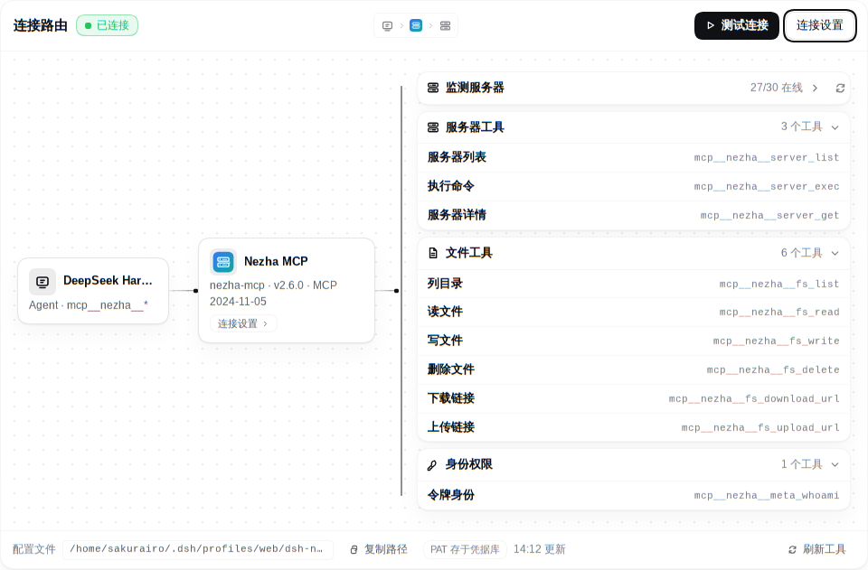
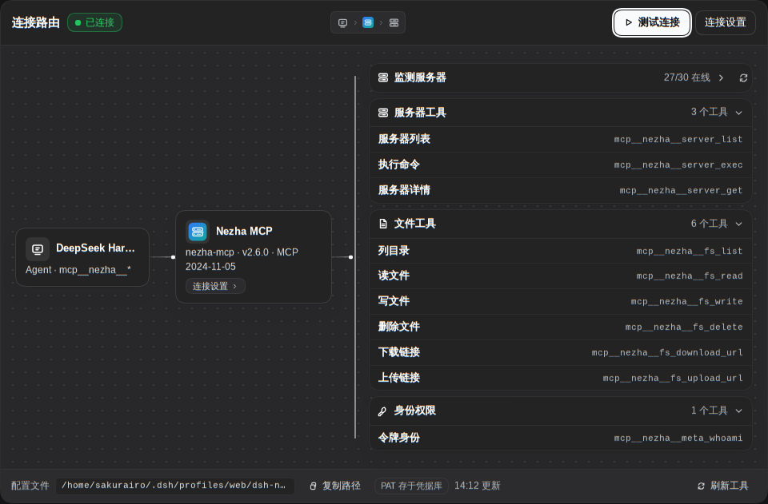
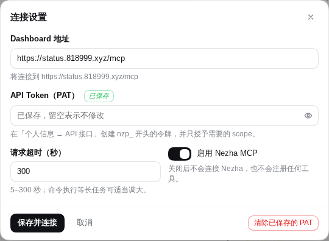
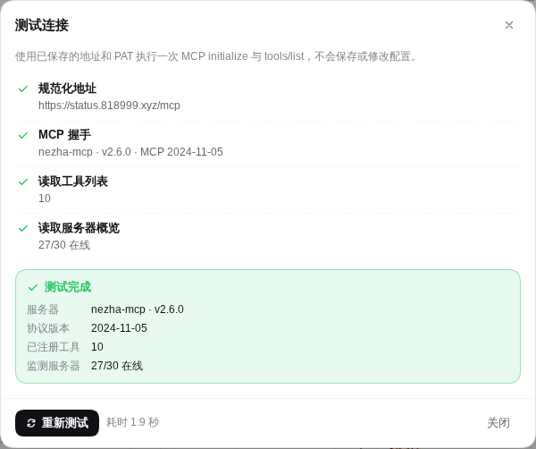

# dsh-nezha

[](https://github.com/kaecho/dsh-nezha/actions/workflows/ci.yml)
[](https://www.npmjs.com/package/dsh-nezha)
[](LICENSE)

**English** | [简体中文](README.zh.md)

A [DeepSeek Harness (DSH)](https://github.com/deepseek-ai/dsh) plugin that connects the built-in MCP server of [Nezha Monitoring V2](https://nezha.wiki/). Once installed, the agent gets a set of `mcp__nezha__*` tools for inspecting servers, running one-shot commands, reading and writing server files, and minting large-file transfer URLs. The dashboard URL, PAT, enable state, and tool refresh are all managed from the plugin detail page in the DSH Web UI. The settings page follows the interaction design of [dsh-grok-search](https://github.com/Lain-in-coding/dsh-grok-search): a connection route, a test-connection dialog, and grouped server/tool views.

> Current version: `0.2.1` · License: MIT · Requirements: DSH `>=0.2.1-rc.2`, Node.js `>=22`, Nezha V2 with `enable_mcp` enabled

## Contents

- [Features](#features)
- [Interface](#interface)
- [Requirements](#requirements)
- [Installation](#installation)
- [First-time setup](#first-time-setup)
- [Tool names](#tool-names)
- [PAT scopes](#pat-scopes)
- [Security](#security)
- [Available tools](#available-tools)
- [Troubleshooting](#troubleshooting)
- [Development](#development)
- [Release process](#release-process)
- [License](#license)

## Features

- Connects to the Nezha dashboard MCP endpoint: `POST /mcp` with `Authorization: Bearer nzp_...` authentication.
- On startup or after saving settings, runs MCP `initialize`, `notifications/initialized`, and `tools/list`, then registers the Nezha tools in DSH.
- Tools are always exposed as `mcp__nezha__<tool>`, for example `mcp__nezha__server_list` and `mcp__nezha__fs_read`.
- Provides a visual connection page inside the DSH plugin detail page: status pill, connection route, collapsible server and tool groups, config path with a copy button.
- Ships a **Connection settings** dialog (URL, PAT, timeout, enable switch, clear token) and a **Test connection** dialog (URL → MCP handshake → tool list → server overview); testing never saves configuration.
- After connecting, reads `server.list` on a best-effort basis to show server online counts and the server list; a dedicated refresh button updates them without reconnecting MCP.
- Turns connection, authentication, permission, 404, rate-limit, and timeout failures into readable error messages.
- No runtime dependencies and no build step; the PAT is stored in the DSH credential store and the plain settings file never contains secrets.
- Accepts both JSON and SSE MCP response bodies; Nezha currently uses request/response POST mode, so no long-lived SSE session is required.
- The UI is available in English and Chinese and follows the DSH locale.

## Interface

<p align="center">
  <a href="https://raw.githubusercontent.com/kaecho/dsh-nezha/main/docs/images/readme-020-route-light.png"></a>
  <br><sub>0.2.0 light theme · Connection route: DSH → Nezha MCP → server and tool groups · click to enlarge</sub>
</p>

<p align="center">
  <a href="https://raw.githubusercontent.com/kaecho/dsh-nezha/main/docs/images/readme-020-route-dark.png"></a>
  <br><sub>0.2.0 dark theme · The same route automatically adapts to the dark palette · click to enlarge</sub>
</p>

<p align="center">
  <a href="https://raw.githubusercontent.com/kaecho/dsh-nezha/main/docs/images/readme-020-settings-light.png"></a>
  <a href="https://raw.githubusercontent.com/kaecho/dsh-nezha/main/docs/images/readme-020-test-light.png"></a>
  <br><sub>Connection settings and test-connection dialogs · the test is read-only · click to enlarge</sub>
</p>

The configuration area on the plugin detail page has three parts:

1. **Connection route**: DeepSeek Harness on the left, the Nezha MCP node in the middle (click it to open connection settings), and expandable **Monitored servers** plus tool groups (server tools, file tools, identity/permissions) on the right. When connected, the wires light up and the view shows the online server count and tool counts.
2. **Connection settings dialog**: dashboard URL (with a live preview of the final `/mcp` endpoint), API token (show/hide, saved marker, clear), request timeout, and the enable switch.
3. **Test connection dialog**: validates URL normalization, MCP handshake, tool list, and server overview in order, with error-code-specific suggestions on failure.

The footer shows the settings file path (copyable), a note about where the PAT is stored, and **Refresh tools**. The detail-page documentation area uses curated guides (`docs/plugin-detail.en.md` / `docs/plugin-detail.zh.md`); this README remains the full reference.

Light and dark themes follow DSH automatically, and the route stacks vertically on narrow screens.

## Requirements

| Item | Requirement |
| --- | --- |
| DeepSeek Harness | `>=0.2.1-rc.2` (see `engines.dsh` in `package.json`) |
| Node.js | `>=22` (needed for development and packing; the DSH runtime bundles its own Node) |
| Nezha | Nezha Monitoring V2 with `enable_mcp: true` in the dashboard configuration |
| Authentication | A Nezha API token (PAT) starting with `nzp_`; a browser login JWT is not accepted |
| Network | The DSH host must reach the dashboard's `/mcp` endpoint over HTTP(S) |
| Reverse proxy | Allows `POST /mcp`, forwards the `Authorization` header, and accepts request bodies of at least 8 MiB |

Nezha disables MCP by default. Enable it in the dashboard configuration file or admin settings first:

```yaml
enable_mcp: true
```

Restart or reload the dashboard afterwards so `/mcp` becomes available.

## Installation

The plugin is published to npm, so installing it is a one-liner: no build step and no dependency build scripts.

### From npm (recommended)

In the DSH Web UI, open the **Plugins** page, choose to add a plugin, enter `dsh-nezha` in "package name or location", then install it and keep it enabled.

Or use the CLI against the profile you boot (for example `web`):

```bash
dsh plugin --profile web add dsh-nezha
```

Restart DSH if the page reports `restart-required`, then reopen the plugin detail page.

### From a local directory (development)

1. Clone or download this repository onto the host running DSH, for example `/path/to/dsh-nezha`.
2. Open the **Plugins** page in the DSH Web UI and choose to add a plugin.
3. Enter the absolute path of the directory, for example `/path/to/dsh-nezha`, in "package name or location", then install it and keep it enabled.
4. If the page reports `restart-required`, restart DSH and reopen the plugin detail page.

### From a local `.tgz` (pinned versions or offline hosts)

Download the `.tgz` attached to the [latest GitHub Release](https://github.com/kaecho/dsh-nezha/releases/latest), or build one from a checkout:

```bash
npm pack
```

The command produces `dsh-nezha-0.2.1.tgz` in the repository root. In the DSH plugin page, choose to install a local bundle and point it at that `.tgz` file. The plugin has no external dependencies, so no dependency build scripts are needed during installation.

After installation, a **Nezha MCP / 哪吒 MCP** entry with its icon should appear in the plugin list.

## First-time setup

1. Open the **Plugins** page in DSH and open the `dsh-nezha` detail page.
2. In the plugin configuration area (the `plugins.bundle.config` slot), fill in:

   | Field | Description |
   | --- | --- |
   | **Dashboard URL** | Nezha dashboard address. You can enter `https://nezha.example.com`, `https://nezha.example.com/nezha`, or the full `https://nezha.example.com/mcp`; the plugin normalizes it to `/mcp`. Do not include credentials, query parameters, or a URL fragment. |
   | **API token / PAT** | A Nezha API token starting with `nzp_`. On save it is written to the DSH credential record `dsh-nezha/token`, never to the plain settings file. Leave it blank to keep the saved token. |
   | **Enable** | When off, the plugin does not connect to Nezha and registers no tools. |
   | **Timeout** | Timeout for a single MCP request, 5–300 seconds, default 60 seconds. Raise it for long-running `server.exec` calls and make sure the reverse proxy timeout is long enough too. |

3. Click **Test connection** and then **Start test**. The test uses the saved URL and PAT (regardless of whether the form is open), runs one `initialize` and `tools/list`, and never saves configuration or executes commands or file operations. The dialog reports the server name, version, protocol version, tool count, and server overview.
4. Click **Save and connect**. The plugin saves the URL, enable state, and timeout to the profile settings file, writes the PAT to the DSH credential store, then reconnects and refreshes tools; the connection route then shows server online counts and tool groups.
5. If you later change the PAT scopes, the Nezha server allow list, or the Nezha version, click **Refresh tools** to reconnect and re-read `tools/list`. To update only the online status, expand **Monitored servers** and click the refresh button; no reconnection is needed.
6. To revoke the saved PAT, open **Connection settings**, click **Clear saved PAT**, and save; the status returns to the unconfigured state.

After saving, the agent can use the `mcp__nezha__*` tools. The tool list comes from the current Nezha instance's `tools/list` response, so available tools may differ slightly between Nezha versions.

## Tool names

DSH registers Nezha's raw tool names as:

```text
mcp__nezha__<tool>
```

Nezha tool names contain dots (for example `server.list`). The plugin replaces dots and other invalid characters with underscores, so the exposed names are:

| Nezha tool | DSH tool name |
| --- | --- |
| `meta.whoami` | `mcp__nezha__meta_whoami` |
| `server.list` | `mcp__nezha__server_list` |
| `server.get` | `mcp__nezha__server_get` |
| `server.exec` | `mcp__nezha__server_exec` |
| `fs.list` | `mcp__nezha__fs_list` |
| `fs.read` | `mcp__nezha__fs_read` |
| `fs.write` | `mcp__nezha__fs_write` |
| `fs.delete` | `mcp__nezha__fs_delete` |
| `fs.download_url` | `mcp__nezha__fs_download_url` |
| `fs.upload_url` | `mcp__nezha__fs_upload_url` |

If a sanitized name exceeds 64 characters, the plugin appends a short hash suffix to avoid collisions. The official tool names in the table above are unaffected in normal cases.

## PAT scopes

Create a dedicated token on the Nezha dashboard's **API / API Token (PAT)** page, select the required scopes and server ID allow list, and set an expiry. `/mcp` only accepts API tokens; it does not accept browser login JWTs, cookies, or OAuth sessions.

Official documentation:

- [Nezha MCP guide](https://nezha.wiki/guide/mcp.html)
- [Nezha API Token (PAT)](https://nezha.wiki/guide/api.html#api-token-pat)

Tool-to-scope mapping:

| Scope | Tools |
| --- | --- |
| Any valid PAT | `meta.whoami` |
| `nezha:inventory:read` | `server.list` |
| `nezha:server:read` | `server.get`, `fs.list`, `fs.read`, `fs.download_url` |
| `nezha:server:exec` | `server.exec` |
| `nezha:server:write` | `fs.write`, `fs.upload_url` |
| `nezha:server:delete` | `fs.delete` |

Follow the principle of least privilege:

- Monitoring and inspection only: grant `nezha:inventory:read` and `nezha:server:read`.
- Add `nezha:server:exec` only if remote command execution is needed.
- Add `nezha:server:write` and `nezha:server:delete` only if files must be modified or deleted.
- For tokens that include `nezha:server:exec`, `nezha:server:write`, or `nezha:server:delete`, set a server ID allow list and a short expiry.

## Security

- **Where the PAT lives**: the PAT is stored in the DSH credential record `dsh-nezha/token` with type `api-key`. The settings page only shows whether a token is configured; it never displays the token value.
- **Plain configuration**: non-secret settings are written to `<profile>/dsh-nezha/settings.json` under the active profile directory (the directory pointed to by the DSH `DSH_PROFILE_DIR` environment variable). The file only contains `url`, `enabled`, and `timeoutMs`; it never contains the PAT.
- **File permissions**: the plugin creates the `dsh-nezha` directory with mode `0700` and writes `settings.json` atomically with mode `0600`. Protect the DSH profile directory, backups, and credential store accordingly.
- **Transport security**: use HTTPS in production and never send the PAT in plain text over public networks. Restrict the reverse proxy to trusted sources and forward `Authorization` correctly.
- **High-risk tools**: `server.exec` runs commands on monitored servers; `fs.write`, `fs.delete`, and `fs.upload_url` modify or delete files. Grant only the scopes you need and rely on DSH's tool permission and confirmation mechanisms.
- **Temporary transfer URLs**: `fs.download_url` and `fs.upload_url` mint one-time URLs that expire after about 300 seconds by default, with a 100 MiB file limit. Unused URLs stop working after the token is revoked or Nezha disables MCP.
- **Revocation**: when the plugin is no longer needed, revoke or delete the PAT in Nezha and clear the saved token in the plugin settings page.

## Available tools

| Tool | Scope | Purpose |
| --- | --- | --- |
| `meta.whoami` | Any valid PAT | Show the current user, admin state, token ID, scopes, and server allow list. |
| `server.list` | `nezha:inventory:read` | List the servers visible to the current token. |
| `server.get` | `nezha:server:read` | Read a single server's Host, State, GeoIP, and similar snapshot data. |
| `server.exec` | `nezha:server:exec` | Run a non-interactive one-shot command on a target server; 30 seconds by default, 300 seconds maximum. |
| `fs.list` | `nezha:server:read` | List a directory's contents. |
| `fs.read` | `nezha:server:read` | Read a file or a byte range; suited to small files and log excerpts. |
| `fs.write` | `nezha:server:write` | Write a file atomically, with optional `if_match_sha256` optimistic locking. |
| `fs.delete` | `nezha:server:delete` | Delete a file or directory; use `recursive` for non-empty directories. |
| `fs.download_url` | `nezha:server:read` | Mint a one-time download URL for files up to 100 MiB. |
| `fs.upload_url` | `nezha:server:write` | Mint a one-time upload URL for files up to 100 MiB. |

Actual tool parameters come from the `inputSchema` returned by Nezha; the plugin registers them as DSH tool parameters and fills in a top-level `object` type when it is missing.

## Troubleshooting

### 401 / authentication failed

- The PAT is invalid, expired, revoked, or was copied with extra whitespace.
- A browser login JWT, cookie, or OAuth session was used by mistake; `/mcp` only accepts API tokens starting with `nzp_`.
- Create a new PAT in Nezha, enter it in the plugin settings, and click **Save and connect**.

### 403 / forbidden

- The PAT lacks the scope required by the tool (see [PAT scopes](#pat-scopes)).
- The PAT's server allow list does not include the target server, or the current user has no permission on that server.
- After adjusting scopes or the allow list, click **Refresh tools** and retry the tool call.

### 404 / MCP endpoint not found

- The URL does not point at `/mcp`. The plugin appends `/mcp` automatically, but make sure the dashboard is actually served at that path and not under some other reverse-proxy sub-path.
- Nezha does not have `enable_mcp: true`, or the dashboard was not restarted after changing it.
- The reverse proxy does not forward `/mcp` to Nezha, or it blocks `POST`.
- Nezha returns 405 for `GET /mcp` and `DELETE /mcp` by design; this plugin only uses `POST /mcp`.

### Connection timeouts / network errors

- Check DNS, TLS certificates, firewalls, and the reverse proxy so that the DSH host can reach the dashboard.
- The reverse proxy should forward `Authorization`, allow `POST`, raise the request body limit to at least 8 MiB, and set a read timeout long enough for long-running `server.exec` calls.
- The plugin's default request timeout is 60 seconds; the settings page allows up to 300 seconds. Nezha's `server.exec` itself defaults to 30 seconds and allows up to 300 seconds.
- With self-signed certificates, configure a trusted CA for the DSH process (for example `NODE_EXTRA_CA_CERTS`) instead of disabling TLS verification.

### 429 / rate limited

Nezha limits each token to roughly 10 requests per second and 120 per minute by default. Reduce concurrency or retry later; split high-frequency inspection into separate tasks.

### Empty tool list or missing tools

- Click **Test connection** first to confirm that `initialize` and `tools/list` succeed.
- Confirm the plugin is enabled and its status is `connected`; saving or refreshing re-registers tools.
- Check the PAT scopes; tools may appear in the list while calls without the right scope still fail.
- If DSH reports `restart-required`, restart DSH.

### `dashboard_host` / temporary transfer URL failures

`fs.download_url` and `fs.upload_url` depend on Nezha's `dashboard_host` configuration. If you see an error such as `MCP transfer URL host is not an operator-declared dashboard host`:

- Set `dashboard_host` in the dashboard configuration to a domain or `IP[:port]` reachable by MCP clients, without `http://`, `https://`, or a path.
- Do not use a NAT service hostname; make sure DSH can reach the address.
- If HTTPS terminates at the reverse proxy, forward `X-Forwarded-Proto: https`, otherwise temporary URLs may be minted with an HTTP address.
- Temporary URLs are single-use and expire after about 300 seconds (600 seconds maximum); the file limit is 100 MiB.

## Development

Node.js `>=22` is required. There are no runtime dependencies and no build step.

```bash
# Validate package.json, cordis.patch.yml, locales, the icon, and JS syntax
npm run check

# Run the node:test suite
npm test

# Run check and test together
npm run test:all

# Inspect the npm package contents without producing a tarball
npm run pack:check
```

`scripts/check.mjs` uses only Node built-ins and has no third-party dependencies. It validates:

- the `name`, `version`, `license`, `engines`, `exports`, `files`, `dsh`, and `scripts` fields in `package.json`;
- the `dsh-nezha` line inserted by `cordis.patch.yml`;
- `meta.title` and `meta.description` in `locale/en.json` and `locale/zh.json`, plus the curated documents referenced by `meta.detail` (they must exist and be published with the package);
- the English and Chinese READMEs, including the language switcher and the README published in `files`;
- that `icon.svg` exists, starts with `<svg`, and is no larger than 256 KiB;
- the syntax of every `.js` / `.mjs` / `.cjs` file in the repository (skipping `node_modules`).

The check does not fail when test files are absent; `npm test` runs `node --test test/*.test.js`, so new tests go in `test/`.

Directory layout:

```text
.
├── src/
│   ├── index.js          # host plugin entry, settings service, tool registration
│   ├── mcp.js            # Nezha MCP client and endpoint/error handling
│   ├── tool-bridge.js    # adapts Nezha tools to DSH ToolDefinitions
│   ├── settings-store.js # non-secret settings persistence
│   ├── descriptors.js    # settings page Remote descriptors
│   └── typert.host.js    # Typert host type description
├── client.js             # web settings page (plugins.bundle.config) and detail badge (plugins.detail.badge)
├── cordis.patch.yml      # DSH bundle patch
├── docs/
│   ├── plugin-detail.en.md # curated plugin detail guide (English)
│   ├── plugin-detail.zh.md # curated plugin detail guide (Chinese)
│   └── images/           # README screenshots (not published to npm)
├── locale/               # English/Chinese display metadata (with meta.detail)
├── icon.svg              # plugin icon
├── scripts/check.mjs     # repository self-check
└── test/                 # node:test suites
```

To verify against a local Nezha instance, enable `enable_mcp`, create a test PAT, enter the URL and token on the plugin settings page, click **Test connection**, and then make read-only calls with `mcp__nezha__meta_whoami` or `mcp__nezha__server_list`. Never use a production token to test `server.exec`, `fs.write`, or `fs.delete`.

## Release process

1. Update the `version` field in `package.json` and record the changes in `CHANGELOG.md`.
2. Commit the changes, push `main`, and create a tag that matches the version:

   ```bash
   git tag v0.2.1
   git push origin v0.2.1
   ```

3. Pushing a tag that starts with `v` triggers `.github/workflows/release.yml`, which:
   - fails unless the tag equals `v` + the `version` in `package.json`;
   - runs `npm run check` and `npm test`;
   - runs `npm pack` and verifies the produced `dsh-nezha-<version>.tgz`;
   - reads the matching `CHANGELOG.md` section as release notes and prepends it to the auto-generated notes;
   - creates or updates the GitHub Release with the `.tgz` asset, and marks it **Latest** only when the tag is newer than the current latest release; re-running the workflow re-uploads the asset safely.
4. Publish the same version to npm from a clean checkout:

   ```bash
   npm publish
   ```

   The release workflow deliberately does not run `npm publish`, so the registry copy is always an explicit local step.

`.github/workflows/ci.yml` runs on pushes to `main` and on pull requests targeting `main`, using Node.js 22 and 24 to run `npm run check`, `npm test`, and `npm pack --dry-run`.

## License

[MIT](LICENSE) © 2026 kaecho
